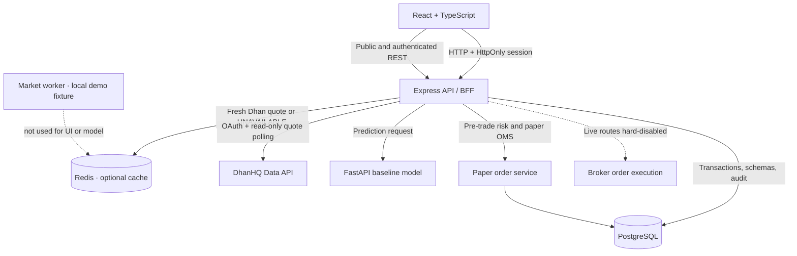

# Runtime architecture

The browser never has database, Redis, model or broker credentials. Local email/password identity is persisted in Postgres; passwords use bcrypt hashes and sessions use signed HttpOnly cookies. Every account, watchlist, paper fill, ledger update and audit entry is scoped to the authenticated user. Paper order state updates are transactionally applied with row locks.

The local market worker still writes demo fixtures to dedicated Redis keys, but the API no longer reads those keys as quote fallbacks. The UI displays verified Dhan quotes only; missing or expired quotes are `UNAVAILABLE`. Charts are empty until verified Dhan historical bars are imported. The Dhan integration polls a mapped NSE equity set after a user completes OAuth consent; the API key/secret alone do not create the required access token. No index, news, or global event provider is connected, so those panels remain empty/unavailable. The ML service has a CPU LightGBM training and inference workflow, versioned candidate manifests, hash checks, purged chronological validation, logistic/momentum comparisons, and a manual promotion gate. It refuses to score synthetic or quote-only inputs; without a separately licensed point-in-time bar dataset and a human-approved artifact, its result is `NO_TRADE` with no fabricated probability. See `services/ml-service/README.md`.

The API owns deterministic paper risk checks. It checks current equity against the loss stop, position count, total deployment, available cash and sellable position before a fill. Live routes return a hard failure and have no broker adapter. The `trading-worker` process remains isolated and paper-only; no LLM or model can place orders. One-minute bar, feed-gap, feature-snapshot, model-version/evaluation, source, and event-entity tables are included for the next point-in-time ingestion and model governance steps.

## Deployment boundary

Compose builds local containers for all application services. Azure currently hosts the React web app, Express API, internal Python ML service, PostgreSQL Flexible Server, Key Vault and Log Analytics. Resource identifiers, ingress and network settings, budget alerts, and operator navigation are recorded in the gitignored `AZURE_ACCOUNT_REFERENCE.md`. The database connection and secret references are configured, with one public firewall allowlist entry for the Container Apps egress IP. Remaining architecture work includes Dhan OAuth consent and data imports, an approved trained artifact, licensed news/index sources, durable model artifact storage, backups/restore validation, alerting/observability, identity enhancements, and external legal/regulatory review. Live order execution remains disabled.
