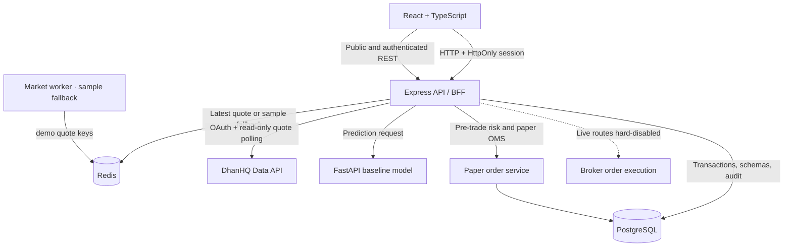

# Runtime architecture

The browser never has database, Redis, model or broker credentials. Local email/password identity is persisted in Postgres; passwords use bcrypt hashes and sessions use signed HttpOnly cookies. Every account, watchlist, paper fill, ledger update and audit entry is scoped to the authenticated user. Paper order state updates are transactionally applied with row locks.

The market worker currently sends synthetic fallback quote fixtures to dedicated demo keys in Redis. When a user authorizes Dhan, the API encrypts its access token in PostgreSQL and polls mapped NSE equity quotes into the live quote keys. Quotes fall back to sample fixtures when the token expires or Dhan is unavailable. Charts, index prices, and existing backtest history remain synthetic. The ML service now has a CPU LightGBM training and inference workflow, versioned candidate manifests, hash checks, purged chronological validation, logistic/momentum comparisons, and a manual promotion gate. It refuses to score synthetic or quote-only inputs; without a separately licensed point-in-time bar dataset and a human-approved artifact, its result is `NO_TRADE` with no fabricated probability. See `services/ml-service/README.md`.

The API owns deterministic paper risk checks. It checks current equity against the loss stop, position count, total deployment, available cash and sellable position before a fill. Live routes return a hard failure and have no broker adapter. The `trading-worker` process remains isolated and paper-only; no LLM or model can place orders. One-minute bar, feed-gap, feature-snapshot, model-version/evaluation, source, and event-entity tables are included for the next point-in-time ingestion and model governance steps.

## Deployment boundary

Compose builds local containers for all application services. Azure infrastructure is partially provisioned; the live resource inventory and exact IDs are in the gitignored `AZURE_ACCOUNT_REFERENCE.md`. The PostgreSQL server currently has public network access disabled and no private subnet attached, so an application cannot yet connect to it. The Azure deployment path also requires reviewed network exposure, a durable model store, a hosted web/API design, approved secrets, and cost confirmation. Exchange/news redistribution rights, official market calendars, Google OAuth, email verification, MFA, and any live algo approvals require external integrations and validation.
