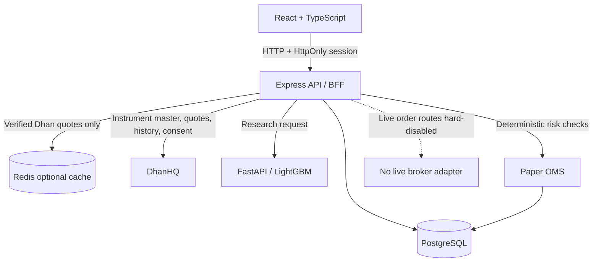

# Runtime architecture

The browser has no database, Redis, model, Dhan API key/secret, or token-encryption key. Passwords are bcrypt hashed; app sessions are signed HttpOnly cookies. Dhan API credentials and the token-encryption key are held in Azure Key Vault; a user's active access token is encrypted before it is stored in PostgreSQL. The token renewal job uses a managed identity and only renews active Web-generated Dhan tokens.

The API loads the official Dhan NSE equity instrument master before listening. Quotes are retrieved from Dhan in batches within the Quote API limit and cached only when Dhan returns valid data. Missing feeds remain `UNAVAILABLE`; there is no synthetic quote publisher or fallback. Index data and verified event/news sources are not connected. Historical bars are persisted only after Dhan history import.

The ML service has CPU-based feature, LightGBM, baseline comparison, chronological purge, metric, artifact-hash and approval code. No approved production model is installed; the current candidate failed validation. It returns `NO_TRADE` without valid data and approval. The paper OMS checks cash, positions, loss and exposure in a database transaction, but its fill and cost assumptions are simplified. Live broker orders have no adapter and remain hard-disabled.

## Deployment boundary and open gates

Azure hosts the web client, API, ML service, PostgreSQL Flexible Server, Key Vault and Log Analytics. Resource IDs, revisions, network configuration, budget, and portal navigation live in the private Git-ignored `AZURE_ACCOUNT_REFERENCE.md`.

The deployed app currently has an active verified Dhan Web token and receives read-only NSE quotes. Full production readiness still requires licensed public-data rights, a public index/news/event provider, systematic import of history under Dhan terms, a passing and approved model, stronger paper OMS replay/fill realism, durable model registry and training pipeline, backups/restore drill, alerting, load/security acceptance, identity hardening, and legal/regulatory review. Do not present this release as ready for unattended or live trading.
