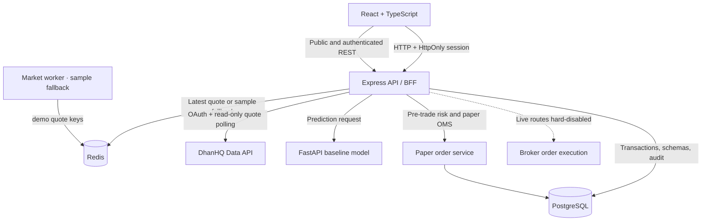

# Runtime architecture

The browser never has database, Redis, model or broker credentials. Local email/password identity is persisted in Postgres; passwords use bcrypt hashes and sessions use signed HttpOnly cookies. Every account, watchlist, paper fill, ledger update and audit entry is scoped to the authenticated user. Paper order state updates are transactionally applied with row locks.

The market worker sends synthetic fallback quote fixtures to dedicated demo keys in Redis. When a user authorizes Dhan, the API encrypts its access token in PostgreSQL and polls mapped NSE equity quotes into the live quote keys. Quotes fall back to sample fixtures when the token expires or Dhan is unavailable. Charts, index prices, backtest history and forecasts remain synthetic. The prediction endpoint calls FastAPI and records the returned model output in the forecasts table.

The API owns deterministic paper risk checks. It checks current equity against the loss stop, position count, total deployment, available cash and sellable position before a fill. Live routes return a hard failure and have no broker adapter. The `trading-worker` process remains isolated and paper-only; no LLM or model can place orders.

## Deployment boundary

Compose builds local containers for all application services. Azure infrastructure code and a production deployment are not provisioned in this project; they require a chosen Azure subscription/region, network design, provider entitlements, secrets, cost approval, and operational ownership. Exchange/news redistribution rights, official market calendars, Google OAuth, email verification, MFA and live algo approvals require external integrations and validation.
